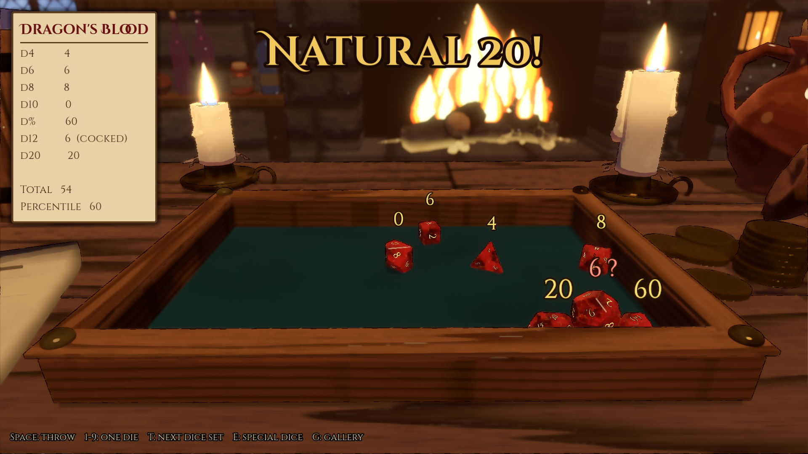

# Tales of the Tumbling Dice (Godot 4)

A dice-collecting RPG told at a tavern table. An unseen storyteller, the Teller, tells you a tale, and every
deed in it is decided by real dice you own, pack and throw into a physical tray. Your Pouch of dice is your
character: no stats, no classes, only the dice you carry and what they have been through.

This build is **milestone M1: The Drowned Bell**, the first tale, playable start to finish. Design doc:
*Tales of the Tumbling Dice: Game Design* (Claude Doc).

Everything is generated in GDScript and shader code: dice, tavern, UI widgets and sounds. The only assets
are two free fonts (SIL Open Font License): Cinzel for headings and dice, and IM Fell English for the
Teller's narration (`fonts/OFL.txt`, `fonts/OFL-IMFellEnglish.txt`).



## Play it

1. Download **Godot 4.7** (standard build, not .NET) from https://godotengine.org/download. Tested on 4.7.1.
2. Open Godot, click **Import**, pick this folder's `project.godot`, then press **F5**.

| Input | Action |
|---|---|
| Click | Choose, pick dice from your Hand, place dice in slots |
| Space | Throw |
| Enter | Confirm / continue |
| F | Fast dice: skip the physics (same odds, results drawn from each die's measured faces) |
| Esc | Quit |

The campaign (your dice, Coin, Chronicle, endings found) is saved to `user://campaign.json` when a tale
ends. Run with `-- --new` to start fresh. The old dice-tray sandbox is still there: `main.tscn`.

### How a tale plays

1. **Wren's plea** at the tavern, then an optional **wager**: stake one of your dice to double the tale's Coin.
2. **Pack the Pouch** from the shelf (weight limit 12) and fill the Saddlebag (weight 4) for the Waystone.
3. **Scenes**: the Teller narrates on the parchment, and you choose what your character does. Options never
   name an aspect or a reward: you decide who you are, then find out how your dice handle it.
4. **Approach**: your Hand of 5 is drawn first, then you pick how to go about it (every option can be done with
   2 or 3 aspects), with the odds for your actual Hand shown on each.
5. **Throw**: pick up to Effort dice (usually 3). Odds per tier update as you pick. The dice tumble in the tray.
   A cocked die can be settled for 1 Fate (free for Bone) or thrown again for free. Echo faces re-throw.
6. **Assign**: put each die in a slot (full value on its own aspect, half elsewhere). Spend Fate to Nudge,
   Reroll or Bump the table. Confirm.
7. **Tier**: Fail, Mixed, Success or Triumph. Mixed lets you choose the price. A Fail earns a Fate token and a
   Grudge on your lowest die, has its own written outcome, and often finds content nothing else reaches.

Challenge kinds: **Tests** (one moment), **Trials** (a Danger clock; throwing your full Effort rushes and ticks
it twice), **social Contests** (they throw first; split your dice between Press and Hold), and **Combat**
(the foe throws first and its dice freeze in the tray; five stances: Strike, Guard, Evade, Trick, Read).

## The Drowned Bell

14 scenes over three acts, three Act II routes that rejoin at the Waystone and the Bell Chamber, five endings
(Rest, Silence, Greed, The Bargain, Drowned). It shows every system once: all five aspects, Trials, two social
Contests, three fights with non-violent alternatives, a card sharp who spots loaded dice, a cursed temptation
(the Bellmetal d20), companion dice (Hobb's oak d6, the Smuggler's Hook), Teller's variations (weather), and a
bottleneck scene that reads everything you did. A first run sees about 10 scenes and 10 to 12 throws.

## Code layout

The rules never touch the scene tree, so the same code runs in the game, in tests and in the balance bots.

| Path | What it does |
|---|---|
| `scripts/rules/dice.gd` | Dice as data: aspects, faces and runes, materials and traits, every die in the slice, measured face distributions |
| `scripts/rules/pouch.gd` | Collection, Pouch (a deck with weight), Saddlebag, Hand, discard, Fatigue, Waystone swaps |
| `scripts/rules/scoring.gd` | Face values, combos (Pair, Triple, Run, Kinship, High Table), Kin, Grudges, the Teller's pity, on/off-aspect, best assignment, tiers |
| `scripts/rules/challenge.gd` | Tests, Trials and the Last Stand |
| `scripts/rules/contest.gd` | Social Contests, including the card sharp's loaded-dice check |
| `scripts/rules/combat.gd`, `foes.gd` | Combat rounds, stances, foe dice kinds and traits, boss phases; foes as data |
| `scripts/rules/odds.gd` | Odds shown before every throw: exact enumeration for final throws, simulation for the rest |
| `scripts/rules/tale_runner.gd` | Plays a tale: a state machine the table and the bots drive through the same calls |
| `scripts/rules/tale_state.gd`, `campaign.gd` | Per-tale memory (Grit, Fate, Wounds, flags, temperament) and the saved campaign |
| `scripts/rules/teller.gd` | The Teller's reaction lines, keyed to events, with a cooldown |
| `scripts/rules/conditions.gd` | The small condition language tales use (`rumour_smugglers or has:guile`) |
| `scripts/rules/bot.gd` | Balance bots with archetype Pouches |
| `scripts/tale/drowned_bell.gd` | The tale itself, as data |
| `scripts/game/game.gd` | The playable table: parchment, cards, Hand, Pouch screen, ending; turns clicks into runner calls |
| `scripts/game/table.gd` | Physical dice: spawns rules dice as rigid bodies, throws, settles, reads faces, freezes the foe's dice |
| `scripts/game/ui_kit.gd` | Paper-and-wax UI styles plus code-drawn widgets (die tiles, odds bar, pips) |
| `tests/run_tests.gd` | Unit tests, the tale linter and the balance bots |

## Tests, linter and balance

```
godot --headless -s res://tests/run_tests.gd                                   # everything, quick bots
godot --headless -s res://tests/run_tests.gd -- --runs=200 --report=media/balance.md
godot --headless --fixed-fps 60 res://game.tscn -- --new --autoplay --quit-at-end --seed=4
```

The last line has a bot play the whole tale through the real UI with physics dice, headless, in seconds.

The linter checks that every challenge has an outcome for all four tiers (and for being caught cheating where a
card sharp sits), every option can be done with 2 or more aspects, no option names an aspect or previews a
reward, every Mixed offers at least two costs, every flag read is set somewhere, and every scene is reachable.
The odds test compares the odds shown against 20,000 simulated throws. Latest report:
[media/balance.md](media/balance.md).

## Rules decisions made while building M1

Where the design doc left a gap or two rules pulled against each other, this is what the code does:

- **Defeat** comes only from failing the Last Stand in the final fight, or from a third Wound. A Last Stand
  failed earlier costs a Wound and moves the story on. This reconciles "Last Stand fail ends the tale" with
  "one throw can't end a run".
- **Defy** turns a single Fail into a Mixed, but not a fight that was lost over several rounds (the Last Stand is
  the fight's safety net).
- **Glint** (Arcane Amethyst): with free assignment the doc's "swap one even die between slots" did nothing, so
  an even-landing amethyst die counts in full in any slot instead.
- **Trials**: each try ticks the Danger clock once; throwing your full Effort rushes and ticks it twice.
- **Social Contests**: three rounds, your Nerve starts at 10. Triumph if they break in round one or you lose no
  Nerve; Mixed if their Resolve ends within 30% of where it started.
- **Combat tiers**: Triumph if you win losing 5 Grit or less, Success if you win, Mixed if you won after a Last
  Stand or fled, Fail if you lost.
- **Card sharps** spot a loaded die 1 time in 2 when it lands on its favoured face and 1 in 6 otherwise; the odds
  are shown when you pick it up.
- The doc's Mire Wolf worked example misses an option: all three dice in Strike (8 + 2 + 4) kill the wolf
  outright. The bot finds it.
- Standard single-try Tests are harsh with a mixed Pouch (three on-aspect dice are rare), so the slice's
  Standard Tests give two tries with progress carrying over, like the doc's flooded-gate example.

Not in M1 (later milestones): Epithets, forging and the Dicewright, the tavern hub and patrons, the parchment
tale map, carved foe figurines, flick-to-throw, the Ink-like tale text format.

## The dice tray (prototype)

The original sandbox: open `main.tscn` and press **F6**.

| Key | Action |
|---|---|
| Space / left click | Throw all dice |
| 1 to 9 | Throw a single die |
| T | Next dice set |
| E | Add or remove the special dice (loaded d6, combat d6) |
| G | Gallery view (dice laid out, highest face toward you) |
| Esc | Quit |

When the dice stop, each one gets a floating number, the parchment lists all results with the total and
the percentile roll (d% + d10), and a natural 20 or a 1 on the d20 gets a banner. A die resting tilted
against a wall or another die shows `?`.

## Dice sets

Each set is the classic seven-piece tabletop set: d4, d6, d8, d10 (0 to 9), d% (00 to 90), d12, d20.

| Set | Look |
|---|---|
| Dragon's Blood | red and black swirled resin, gold sparkle, gold numbers |
| Ancient Bone | ivory with brown ink |
| Elven Jade | green and white marble, white numbers |
| Dwarven Brass | brushed metal, black engraved numbers |
| Arcane Amethyst | purple with starry glints |

Special dice (press E):
- **Loaded d6**: its centre of mass is shifted toward the 1, so it rolls a 6 about 75% of the time.
  Tune `load` in `dice_catalog.gd` (0 is fair).
- **Combat d6**: words instead of numbers (`MISS, ATK, ATK, DEF, HEAL, CRIT`).

A new set is one dictionary of numbers in `scripts/dice_catalog.gd`:

```gdscript
{"name": "Frost Giant", "a": Color("#bfe6ff"), "b": Color("#2a5a8a"), "swirl": 1.5, "scale": 1.6,
 "rough": 0.2, "sparkle": 0.8, "sparkle_color": Color.WHITE,
 "ink": Color("#0a1a30"), "ink_outline": Color("#6a9ac0")},
```

Any die can also take a `labels` array for custom faces, e.g. `["1", "2", "BURN", "BURN", ...]`.

## What's in it

| File | What it does |
|---|---|
| `scripts/dice_geometry.gd` | Builds the polyhedra (tetrahedron, cube, octahedron, pentagonal trapezohedron, dodecahedron, icosahedron) from maths, and rounds the edges of any convex shape (dice, tray, furniture). |
| `scripts/die.gd` | A `RigidBody3D` that turns a spec into a rounded-edge mesh, numbers and a convex collider, and reads which face is up. |
| `scripts/materials.gd` | Procedural shaders with bump relief: wood planks, stone blocks, velvet, parchment, marbled/metal dice, brass, coins, wax, ale foam, glowing coals. |
| `scripts/props.gd` | Code-built prop shapes: lathed candles with melted rims and wax drips, brass dishes, bent firewood, cartoon flame cards, a tankard with spilling foam, jug, bottles and flasks, barrels with a tap, a coin pouch, curled parchment, hanging lanterns. |
| `scripts/sfx.gd` | Sounds synthesised at startup (no audio files): dice clacks on wood, thumps on felt, die-on-die clicks, and a looping log-fire crackle. |
| `scripts/tavern.gd` | The inn: table, dice tray, fireplace with particle fire, candles, tankard, coins, shelves, barrels, flickering lights. |
| `scripts/dice_catalog.gd` | Data-only dice sets and special dice. |
| `scripts/main.gd` | Camera, throwing, results, parchment UI, banners. |
| `scripts/stats.gd` | Headless fairness test: throws each die thousands of times and runs a chi-squared check. |

**Face-up detection.** Each face's outward normal is stored in the die's local space. After the throw the
die rotates each normal into world space and picks the one closest to straight up. The d4 uses its corners
instead, with numbers printed near each corner like a real d4.

**Rounded edges.** Each face is shrunk toward its centre and the gaps are filled with edge strips and
corner caps whose normals blend between faces. The rounded shape is also the collision hull, so dice roll
a little more freely than sharp ones.

## Art direction: stylized, painterly

Warm hand-painted tabletop look (references: Hearthstone's tavern, Sea of Thieves lighting, Wind Waker fire,
Arcane's brushwork). Three pieces make it:
- **Toon light** (`TOON_LIGHT` in `materials.gd`, spliced into every lit shader): light falls off in soft bands
  with brush-wobbled edges, crisp highlight shapes, a painted rim, and violet ambient shadows against warm fire.
- **Painterly screen pass** (`POST`): a soft Kuwahara filter smears the image into brush patches and dark-brown
  ink lines trace depth and shape edges. Forward+ only. Set `brush_px` to 0 to keep the lines without the smear.
- **Silhouettes from code** (`props.gd`): real shapes instead of plain cylinders, plus cartoon flame cards.

Set `Mats.toon = false` to go back to the smooth, realistic lighting.

Small touches that make the room feel alive: dust motes drift through the lantern light, the background
softens with depth of field, the camera breathes slightly, flames lean when dice slam into the tray, and the
moonlit window cools the warm firelight.

## Sound

Every sound is generated in `sfx.gd` when the game starts: a few decaying sine tones (the ring of a struck
object) plus a short noise burst, written straight into 16-bit audio. Dice pick the sound by what they hit
(velvet, wood, another die) and set the volume by impact speed. The fireplace plays a seamless crackle loop
positioned in 3D.

## Fairness test

```
godot --headless --fixed-fps 120 res://stats.tscn -- --rolls=2000 --out=stats.md
# options: --only=d12   --seed=42
```

About 15 seconds for 2,000 throws of every die. Latest results: [media/stats.md](media/stats.md). All
regular dice pass, and the loaded d6 rolls a 6 about 75% of the time. Around 5% of throws end with a die
leaning on another one; those are counted separately as "cocked".

## Rendering without a window (how the media was made)

Uses Forward+ on the software Vulkan driver (lavapipe), at about 1.5 s per 1080p frame:

```
xvfb-run -s "-screen 0 1920x1080x24" godot --rendering-driver vulkan --resolution 1920x1080 --fixed-fps 30 \
  --write-movie out/f.png res://main.tscn -- --capture --seed=35 --theme=0 --shot=out/result.png
xvfb-run -s "-screen 0 1920x1080x24" godot --rendering-driver vulkan --resolution 1920x1080 --fixed-fps 30 \
  res://main.tscn -- --gallery --theme=3 --shot=out/gallery.png
```

Other options: `--still` renders the room without throwing or UI, `--extras` adds the special dice, `--cam=x,y,z,tx,ty,tz` moves the camera.

## Technical choices

- **Godot 4 over Unity**: free and open source, a 100 MB download with no account, and everything here is
  plain text scripts that are easy to generate and diff. It also runs headless for automated tests and
  renders, which suits a game that is mostly code.
- **Jolt physics** at 120 ticks per second, gravity 25 so the dice tumble at a believable speed for their size.
- **Forward+ renderer** with ambient occlusion, bounced light, soft shadows, volumetric haze and 4x MSAA.
  On a machine without Vulkan, Godot falls back to the Compatibility renderer automatically: it still
  runs, without the haze and contact shadows.
